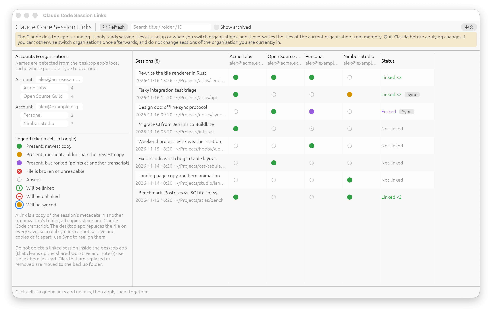
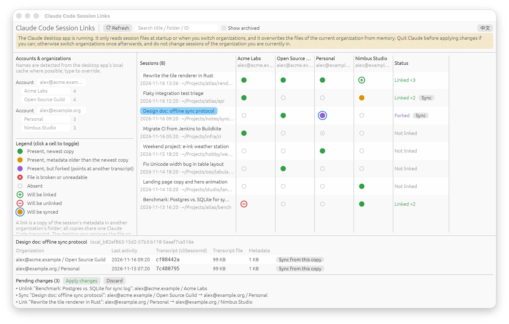
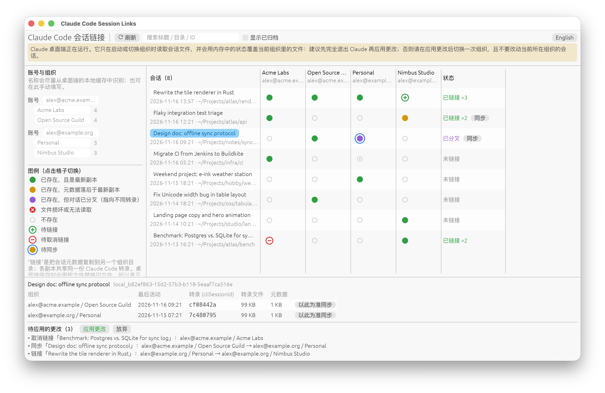

# claude-code-ln

English | [中文](README.zh.md)

A small GUI tool for managing **"soft links" of Claude Code sessions between organizations** in the Claude desktop app.



## How it works

The Claude desktop app stores the metadata of each Claude Code session in one file:

```text
<data dir>/claude-code-sessions/<account UUID>/<organization UUID>/local_<session UUID>.json
```

The `cliSessionId` in that file points at the actual conversation transcript,
`~/.claude/projects/<project>/<cliSessionId>.jsonl` (the session you see in the Claude Code TUI).
Which organization a session appears under depends only on which organization folder the file is in.
Put the same `local_*.json` into several organization folders and those organizations share one
session: a many-to-one "soft link".

This tool makes that visual: a **sessions × organizations** matrix where you click cells to link and unlink.

## Install

**macOS**: download the `.dmg` from the [latest release](https://github.com/XDflight/claude-code-ln/releases/latest)
(universal: Apple silicon and Intel, macOS 11+) and drag the app to Applications. The app is not
notarized, so macOS blocks the first launch: open **System Settings → Privacy & Security** and click
**Open Anyway**, or run:

```bash
xattr -dr com.apple.quarantine "/Applications/Claude Code Session Links.app"
```

**Windows**: download `…-windows-x64-setup.exe` from the same page. It installs per user, without
administrator rights. The installer is not code-signed, so SmartScreen shows a warning: click
**More info → Run anyway**.

**Linux**: download the `.deb` (Ubuntu 22.04+ / Debian 12+, x86_64) and install it with
`sudo apt install ./claude-code-ln-…-linux-amd64.deb`, or unpack the `.tar.gz` and run the binary.

**From source** (any platform):

```bash
cargo run --release
```

## Usage

- **Click an empty cell** to link the session into that organization; **click a filled cell** to unlink it from there. Changes are queued in the bar at the bottom and only written when you click **Apply changes**.
- **Sync**: copies drift apart over time (see below). Sync overwrites the other copies with the newest one, or with a copy you pick.
- **Names**: the desktop app names its folders by UUID only. The tool reads account e-mails and organization names, read-only, from the local cache (IndexedDB) of the claude.ai page embedded in the desktop app, and the account and organization the Claude Code CLI is logged in to from `~/.claude.json`. The cache only holds the account currently signed in, so detected names are remembered in the tool's own settings. Anything not detected can be typed in the side panel; typed names win.
- **Columns** can be resized by dragging their right edge.
- **Language**: English by default; the button in the top right switches to Chinese (remembered).
- Click a session title to see every copy in detail: transcript ID, whether the transcript file exists, last activity, and so on.



Cell colors: green = newest copy, amber = metadata is behind, purple = forked (two copies point at
different transcripts), red = broken file.

Command-line options: `--root <dir>` sets the session store, `--projects <dir>` sets the transcript
directory (handy for trying the tool on a copy).

## Things to know

These come from reading the desktop app's implementation and may change when the app updates:

- **A link is a copy, not a symlink.** The app saves a session by writing a temp file and renaming it, so a real symlink or hard link is replaced by a regular file on the next save. Copies therefore drift apart; use Sync to realign them.
- **The app only reads these files at startup or when you switch organizations**, and it overwrites the files of the current organization from memory. The safest approach is to quit Claude before applying changes. Otherwise, switch organizations once afterwards to see new links, and do not change sessions of the organization you are currently in. The tool shows a notice while the app is running.
- **Do not delete a linked session inside the desktop app.** The app's delete also cleans up the worktree and notes that are shared by session ID. To make a session disappear from one organization, use Unlink here.
- When two organizations both continue the same session, the transcripts can fork (shown in purple).

## Safety

- Transcripts (`.jsonl`) are never touched.
- Linking never overwrites an existing file. Writes are atomic (temp file in the same folder, then put in place) with mode `0600`.
- Files replaced by Sync or removed by Unlink are first moved to
  `<tool data dir>/backups/<timestamp>/<account>/<organization>/`
  (on macOS the tool data dir is `~/Library/Application Support/claude-code-ln/`).
- The last readable copy of a session is never removed.
- Before applying, the tool rescans the disk and stops if the plan you confirmed would no longer be the plan that runs.

## Building

Requires Rust (edition 2024). The GUI uses [egui / eframe](https://github.com/emilk/egui); CJK glyphs
come from system fonts. No cryptographic primitives are used (copies are compared byte for byte;
`snap` only decompresses the IndexedDB cache).

```bash
cargo test
cargo build --release
```

`packaging/package-macos.sh` builds the universal `.app` and `.dmg` into `dist/`. The release
workflow (`.github/workflows/release.yml`) builds and packages all three platforms when a `v*` tag is pushed.

Developed and used on macOS. The Windows and Linux builds compile and pass the unit tests in CI, but
the app has not been run interactively there; in particular, locating the desktop app's data
directory and detecting whether it is running are untested on those platforms.

## Screenshots

The screenshots use fictional data generated by [`docs/make-demo-store.py`](docs/make-demo-store.py).
Run the tool with `HOME` pointing at the generated directory, and set `CLAUDE_CODE_LN_DEMO=1` to
start with a session selected and a few changes queued (nothing is applied).

The interface in Chinese:


